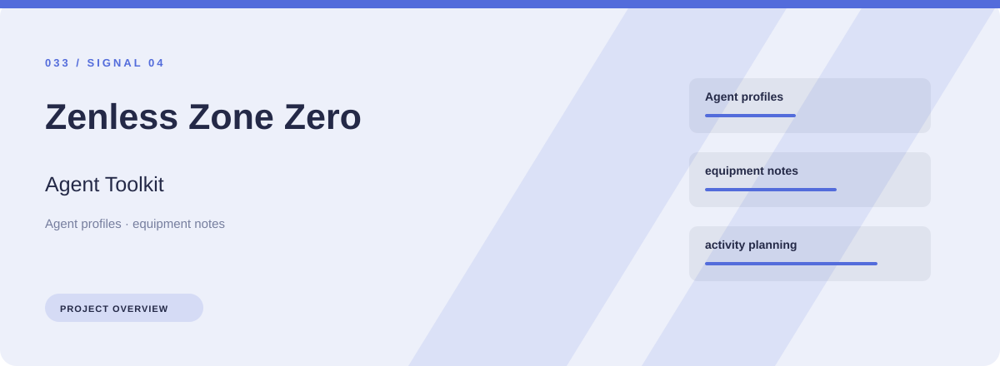
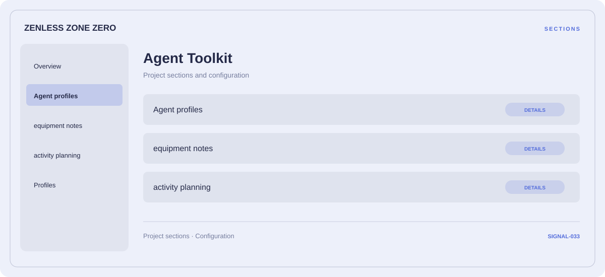

# 🎮 Zenless Zone Zero Agent Toolkit

**Agent profiles · Equipment notes · Activity planning**

## ⚡ Features

Zenless Zone Zero Agent Toolkit focuses on three connected areas: agent profiles, equipment notes, activity planning. Its organization keeps frequently used options close to the context they belong to.

### ⚙️ Agent profiles

Related settings collected into named groups for a clearer configuration workflow.

### 🧩 Equipment notes

Equipment categories and the associated selection or configuration options.

### ⌨️ Activity planning

Session and activity information grouped by the task or context it belongs to.

## 🖥️ Project navigation

## 📥 Download

The button and cover open the project's download page. Use the information supplied with the downloaded package for installation and release-specific requirements.

## 📚 Project documentation

- [Feature reference](docs/FEATURES.md)
- [Download information](docs/DOWNLOAD.md)
- [Project page](index.html)

---

Zenless Zone Zero Agent Toolkit · Program documentation and download information.
                                                                                                    